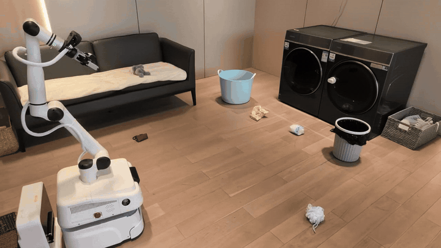

<h1 align="center">RoboRSI</h1>

<p align="center">
  <strong>在真实复杂场景中实现稳定、高效、可复用的机器人自进化。</strong>
</p>

<p align="center">
  <a href="README.md">English</a> | 简体中文
</p>

<p align="center">
  <a href="https://arxiv.org/abs/2610.12424"></a>
  <a href="LICENSE"></a>
  
  
</p>

RoboRSI 是一套机器人自进化的 Multi-Agent 框架。Manager 负责任务拆解,Planner
生成可执行计划,Engineer 在真实环境中驱动技能执行,独立的 Reviewer 依据可见
trace 做诊断。自顶向下的技能细化(TSR)把所有能力组织在一棵任务—技能树上:
在线探索寻找解法,稳定流程固化为代码,执行数据可以训练 learning-based
policy,失败则回到最早出错的节点修订。

论文:<https://arxiv.org/abs/2610.12424> · 项目主页:<https://lab.noematrix.ai/blog/2-roborsi/>

<p align="center">
  <br>
  <em>真机完整任务链(16 倍速)—— <a href="https://lab.noematrix.ai/blog/2-roborsi/">完整视频与精确工具调用链见项目主页</a></em>
</p>

<p align="center">
  
</p>

## 实验结果

以下是[论文](https://arxiv.org/abs/2610.12424)表 1 的仿真结果。所有方法都使用
GPT-5.6-SOL。成功率 = 成功 episode / 有效 episode;覆盖率按任务计,一个任务
首次成功后计一次。

| Benchmark | 协议 | 成功率 | 覆盖率 | 最强 baseline(OpenETA) |
|---|---|---:|---:|---:|
| LIBERO | 30 个任务 × 5 个 episode,边测边进化 | **84/150(56.0%)** | 24/30 | 76/150(50.7%) |
| LIBERO-PRO | 120 个任务 × 5 个 episode,边测边进化 | **297/600(49.5%)** | 102/120 | 231/600(38.5%) |
| LIBERO-Plus | 30 个任务的 840 个扰动实例,LIBERO 技能库冻结 | **354/840(42.1%)** | 28/30 | 306/840(36.4%) |
| RoboTwin | 50 个任务,在线运行的前 154 个 episode | **37/154(24.0%)** | 26/50 | 32/150(21.3%) |

论文中的消融实验:

| 实验 | 结果 |
|---|---|
| 角色分离(RoboTwin,完整在线运行) | Planner + Engineer + Reviewer 解决 36/50 个任务;单个 Engineer 解决 9/50 |
| 代码固化(LIBERO-Plus 的 120 个任务 × 5 个 seed,配对比较) | Code on 174/600(29.0%),Code off 129/600(21.5%);token 中位数 −29.4%,模型调用 −27.2%,墙钟时间 −17.0% |
| 用执行数据训练策略(ACT,10,000 步) | 相对动作块起点的关节目标:click_bell 4/10;click_alarmclock 训练布局 6/7、未见布局 2/3;绝对关节目标全部失败 |

视频与精确工具调用链见[项目主页](https://lab.noematrix.ai/blog/2-roborsi/)。

## 工作原理

```
long_horizon/<task>/   任务族:用户指令 → 有序的原子任务序列
        ▼
atomic/<task>/         原子任务:边界明确、结果可验证;稳定路径固化为代码
        ▼              (例如 visual_pick_place)
base/<robot>/<prim>/   基础技能:感知、运动、抓取、放置 —
                       既可被原子任务调用,也作为工具暴露给 Agent
```

```
Manager ──► Planner ──► Engineer ──► Reviewer
任务队列     plan.md     工具循环     根因定位 + 修订提案
```

任务反复失败时,Reviewer 定位最早出错的节点并提出技能修改提案;提案必须在
真实仿真任务上通过无回退门禁才能提交。每次通过的修改都是一个普通的 git
commit,全部历史可审计。

评测(`roborsi eval` / `eval-suite`)用同一条角色链在冻结 release 上运行,
自进化与持久写回被禁用。成功与否只由仿真器自身的判定谓词在 Agent 循环结束
后裁定;journal 只追加不修改,`roborsi eval-audit` 可独立复核分数。

## 安装

### 一键复现

```bash
git clone --recursive https://github.com/nssmd/RoboRSI.git && cd RoboRSI
export OPENAI_API_KEY="..."            # 任意 OpenAI 兼容 Responses 端点
export ROBORSI_EVAL_MODEL="..."        # 论文使用 GPT-5.6-SOL
scripts/reproduce_paper.sh libero       # LIBERO,30 个任务 × 5 个 episode,进化模式
scripts/reproduce_paper.sh libero-pro   # LIBERO-PRO,120 个任务 × 5 个 episode,进化模式
scripts/reproduce_paper.sh libero-plus  # LIBERO-Plus,840 个实例,LIBERO 技能库冻结
```

每条命令自动完成:创建隔离环境 → 安装 RoboRSI → clone LIBERO-PRO → 从
HuggingFace 官方数据集
[`zhouxueyang/LIBERO-Pro`](https://huggingface.co/datasets/zhouxueyang/LIBERO-Pro)
下载扰动资产 → 体检后端 → 启动 PyRoKi IK/轨迹优化服务(配置了 GraspGen 时也
一并启动)→ 按论文协议运行 → 复核 journal → 输出成功率和覆盖率。`libero` 与
`libero-pro` 边测边进化,进化发生在输出目录下的技能库副本上;`libero-plus`
冻结使用 `libero` 运行得到的技能库和 wiki,所以要先跑 `libero`。所有命令都可以
断点续跑。系统在运行中学习,结果随模型和运行过程变化,不会和上表完全一致。

`scripts/reproduce_libero_pro.sh` 是另一种更严格的测量:当前版本冻结,LIBERO-PRO
每个任务只跑一次(Pass 1),不对应论文中的实验。见
[docs/EVALUATION.md](./docs/EVALUATION.md)。

RoboTwin 需要单独的 conda 环境,见 [docs/sim-robotwin.md](./docs/sim-robotwin.md)。

推荐的模型、GPU、并行数和预算设置见
[docs/EVALUATION.md#recommended-setup](./docs/EVALUATION.md#recommended-setup)。

### 手动安装

见 [docs/INSTALLATION.md](./docs/INSTALLATION.md) 与
[docs/DOCKERINSTALLATION.md](./docs/DOCKERINSTALLATION.md)。

接入自己的真机：见 [roborsi/embodied/embodiment/README.md](./roborsi/embodied/embodiment/README.md)。

```bash
pip install -e ".[libero]"
git clone --depth 1 https://github.com/Zxy-MLlab/LIBERO-PRO.git
hf download zhouxueyang/LIBERO-Pro --repo-type dataset --local-dir ./LIBERO-PRO-assets
roborsi libero configure \
  --root ./LIBERO-PRO \
  --bddldir ./LIBERO-PRO-assets/bddl_files \
  --initdir ./LIBERO-PRO-assets/init_files
roborsi libero doctor --backend libero --task libero_object/0 --reset
roborsi web   # 演化看板 :8787
```

## 社区

扫码加入微信或飞书用户交流群(二维码会定期更新):

<p align="center">
  
  &nbsp;&nbsp;
  
</p>
<p align="center"><em>微信群 &nbsp;·&nbsp; 飞书群</em></p>

## 引用

```bibtex
@article{wen2026roborsi,
  title   = {RoboRSI: Stable, Efficient, and Reusable Robot Self-Evolution in Complex Real-World Environments},
  author  = {Wen, Zimo and Chen, Yijin and Cao, Yuxuan and Chen, Wendi and Zou, Yanwen and Yu, Wenye and Kuang, Fuhang and Xue, Han and Lv, Jun and Wen, Chuan and Lu, Cewu},
  journal = {arXiv preprint arXiv:2610.12424},
  year    = {2026}
}
```
